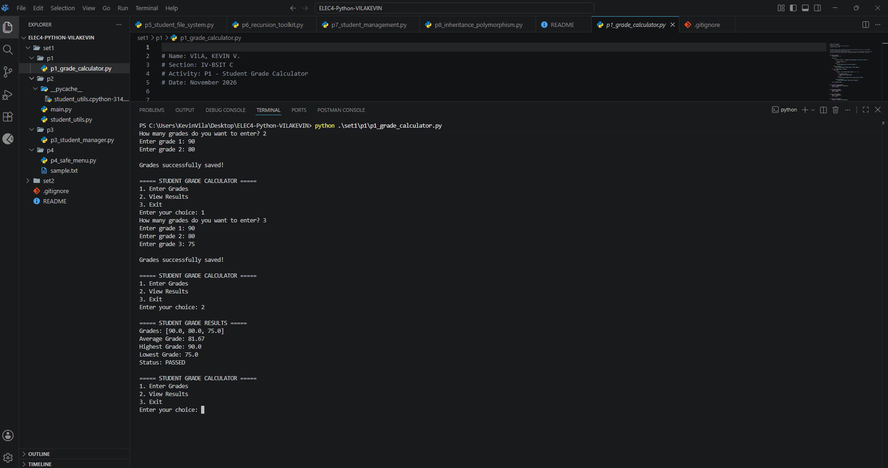
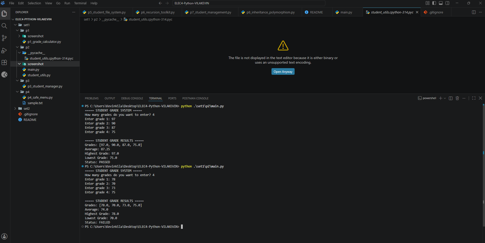
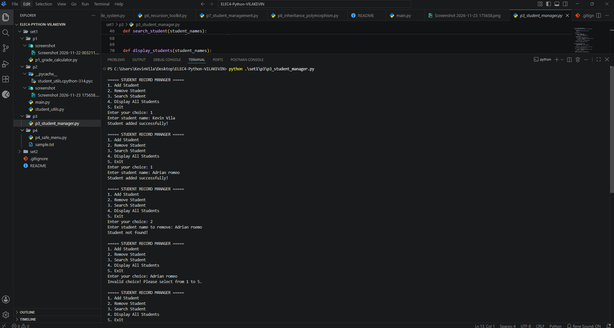
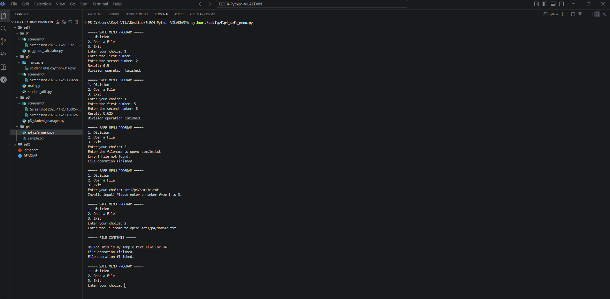

# ELEC4-Python-Vila

Full name: Kevin V. Vila  
Section: IV-BSIT C  
Course Code: ELEC 4 - Python Programming  
Course Title: Python Programming

## Set 1 Activities

| Activity | Description                   | Folder                 |
| -------- | ----------------------------- | ---------------------- |
| P1       | Student Grade Calculator      | [set1/p1](set1/p1)     |
| P2       | Custom `student_utils` module | [set1/p2](set1/p2)     |
| P3       | Student Record Manager        | [set1/p3](set1/p3)     |
| P4       | Safe Menu Program             | [set1/p4](set1/p4)     |

## How to Run

```powershell
python set1/p1/p1_grade_calculator.py
python set1/p2/main.py
python set1/p3/p3_student_manager.py
python set1/p4/p4_safe_menu.py
```

## Screenshots

Screenshots for each activity are placed in their respective folders.

### P1 - Student Grade Calculator



### P2 - Custom Module: Student Utilities



### P3 - Student Record Manager




### P4 - Safe Menu Program



## Technologies Used

- Python
- Visual Studio Codium
- Git
- GitHub

## Repository Organization

The repository contains four Python programming activities organized inside the `set1` folder. Each activity has its own source code and screenshots.

The `.gitignore` file is included to prevent unnecessary Python cache files from being uploaded to the repository.